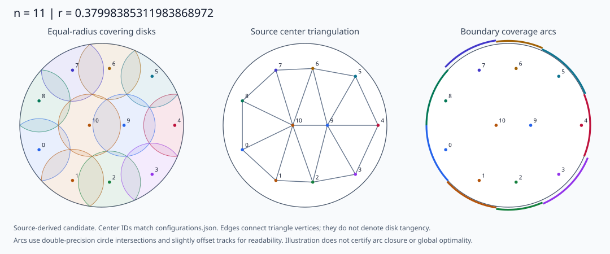
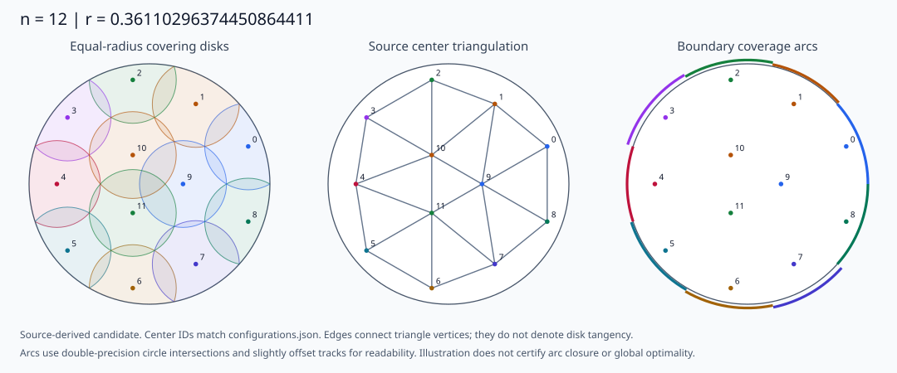
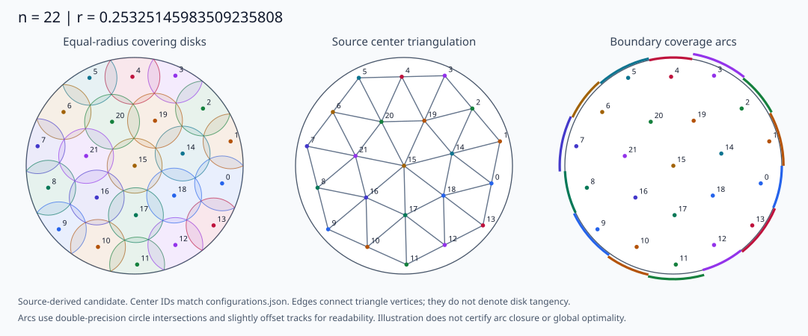

<!-- SPDX-License-Identifier: MIT -->
# DiskCoveringProofs

[](https://doi.org/10.5281/zenodo.23344751)

Covering the closed unit disk with congruent disks: archived source proofs,
exact certificates, and reproducible mathematical checks.
单位闭圆盘的等半径圆盘覆盖：源证明、精确证书与可复现数学检查。

For arbitrary centers $c_i\in\mathbb R^2$, the problem is to determine

$$
r_D(n)=\inf_{c_1,\ldots,c_n}\max_{x\in D}\min_i\lVert x-c_i\rVert,
\qquad D=\{x:\lVert x\rVert\leq1\}.
$$

Agents continuing the project should start at [START_HERE.md](START_HERE.md)
and run `python tools/project_status.py --check`. The machine-readable
[project state](PROJECT_STATE.json) separates current progress, authoritative
hashes, available bundles, missing assets and the next actions for every order.

Start with the [mathematical reader's guide](docs/MATHEMATICAL_GUIDE.md) and
[notation dictionary](docs/NOTATION.md). They translate names such as `C450`,
`C891`, `C924`, `k10`, and `root25` into mathematical statements and domains.
编号是归档索引；先看数学名称、量词、证明链与实际执行范围。

## Run mathematical checks / 运行数学检查

Use Python 3.10 or later. The twelve-disk atomic replay additionally requires
NumPy; the other checker computations use the Python standard library.
The new checkers use repository-relative data paths and write fresh reports.

```sh
python -m pip install -r requirements-math.txt
make check-math-n11
make check-math-n12
```

Without Make, including on Windows, use the same direct entry points:

```sh
python tools/check_math.py n11 --report build/math-n11.json
python tools/check_math.py n12 --workers 4 --report build/math-n12.json
```

| Entry point | Fresh mathematical computation | Scope of a successful result |
|---|---|---|
| `check-math-n11` | Recomputes the 12-dimensional isolated root, same-root threshold, attaining-candidate interval geometry, and all 371 rational Schur energy fields. | A **scoped arithmetic check**. It does not replay the global two-circle bound, all metric-class exclusions, or all global oracle leaves. Read [N11_CHECK_SCOPE.md](docs/N11_CHECK_SCOPE.md). |
| `check-math-n12` | Recomputes exact root isolation, the full hub-domain partition, all 318 infeasibility predicates, and all 6723 atomic capture inequalities, without using cached acceptance verdicts. | The **complete 7041-terminal-box `k10` branch arithmetic**, plus root isolation. The analytic cover-to-domain reduction, attainment, and other branches of the global theorem remain separate source obligations. |

The complete twelve-disk command performs substantial computation; its report
records the number of fresh inequalities and subdivided ring-center boxes.
To inspect a small sample first, run
`python tools/check_math.py n12 --quick --workers 2`.
A sampled run is explicitly labeled **NOT FULL**.
Neither command claims a complete global-proof replay. The `--require-global`
option turns that unmet requirement into a failed command.

中文范围说明：`n11` 的入口给根、阈值、达到构型的区间几何与371个能量场消元检查，仍不等于
全局下界重放；`n12` 默认重新计算十活跃盘分支全部 7041 个终端盒的数学条件，
不读取缓存结论。这个完整分支也不替代全局定理的解析归约和其他分支。
核验项目及数量以本次生成的报告为准。

## Results and archive status / 成果与归档状态

The repository contains orders **11, 12, 14, 21, 22, 23, 24, 25, and 26**.
These are archived source-proof and acceptance states. A new upload, byte
verification, or partial mathematical replay does not establish a new global
theorem. Complete Lean/Coq formalization, external peer review, novelty priority,
and classification of all optimal configurations are not claimed.

| $n$ | Radius rounded to 20 decimal places | Exact object / 精确对象 | Archived source status / 原来源状态 |
|---|---|---|---|
| 11 | $0.37998385311983868972$ | Boxed contact/stationarity root, radius coordinate / 接触与驻定隔离根 | [Global source proof `C924`](cover11/README.md); separate Lean formalization incomplete. / 非完整 Lean 形式化 |
| 12 | $0.36110296374450864411$ | Boxed algebraic solution $F=G=H=T=0$, radius coordinate / 四方程隔离根 | [Global source proof `C1141`](cover12/README.md) / 全局源证明 |
| 14 | $0.33173203427623412256$ | Boxed $F=G=H=0$ root with positive radical branches / 正根分支隔离根 | [Global source proof `C1372`](cover14/README.md) / 全局源证明 |
| 21 | $0.26284507240358458065$ | Square root of boxed core-system radius-squared coordinate / 核心系统隔离根 | [Historical complete global delivery](cover21/README.md), recheck scope retained. / 保留复查范围 |
| 22 | $0.25325145983509235808$ | $\sqrt{t_*}$, isolated root of $29t^3-55t^2+19t-1$ / 三次方程的平方半径根 | [Historical complete global delivery](cover22/README.md), recheck scope retained. / 保留复查范围 |
| 23 | $0.24995377658605018325$ | Square root of boxed core-system radius-squared coordinate / 核心系统隔离根 | [Accepted global source proof](cover23/README.md) / 已接受全局源证明 |
| 24 | $0.24530165016852390995$ | Square root of boxed core-system radius-squared coordinate / 核心系统隔离根 | [Accepted global source proof](cover24/README.md) / 已接受全局源证明 |
| 25 | $0.23914631173810026822$ | $1/(\sqrt6+\sqrt3)$ | [Accepted global source proof](cover25/README.md), original qualification retained. / 保留接受件限定 |
| 26 | — | Candidate root only / 仅候选根 | [**Global proof incomplete**](cover26/README.md) / **全局证明未完成** |

Decimals are displays, not exact root definitions. For the eleven-disk system,
read the [boxed root definition](cover11/proof_bundle/research-2026/team-current/lead/N11-GLOBAL-OPTIMALITY-THEOREM.md);
for twelve disks, read the [four equations](cover12/proof_bundle/research-2026/n12-global/lead/GLOBAL-SYNTHESIS.md).
The twenty-two-disk polynomial is in **squared radius** and its isolating
interval is $(641/10000,321/5000)$; the
[same-root link](shared/proof_bundle/research-2026/n21-25-synthesis/round3-high/N22-GLOBAL-PROOF.md)
identifies it with the attaining core root. Read each source for the branch,
root proof, attainment, and lower-bound quantifiers.
The [radius index](assets/configurations/radius-index.json) gives source-bound
rounded displays for all eight completed source-proof orders, with their exact
definition entries and available symmetry information.

## Configuration atlas / 构型图集

| Eleven disks / 十一盘 | Twelve disks / 十二盘 | Twenty-two disks / 二十二盘 |
|---|---|---|
| [](assets/configurations/n11.svg) | [](assets/configurations/n12.svg) | [](assets/configurations/n22.svg) |

The [atlas](docs/CONFIGURATIONS.md) explains the coverage drawings, center
triangulations, and boundary anchors, including additional diagrams for 14 and
25 disks. Download the
[center coordinate table](assets/configurations/coordinates.csv) or the
[machine-readable configuration data](assets/configurations/configurations.json).
The [source map](assets/configurations/provenance.json) records where the
coordinates come from. Drawings and approximate coordinates aid reading;
the exact root certificates and whole-disk arguments carry the proof.
图形与近似坐标用于理解构型；精确含义由原根证书和全闭盘覆盖论证给出。

## Delivery integrity / 交付完整性

```sh
python tools/verify_delivery.py
python tools/restore_large_files.py --destination ../restored
```

The first command checks submitted bytes, SHA256, and lossless packaging.
The second restores packaged large files into a new directory and refuses to
overwrite different contents. These are integrity tools, separate from the
mathematical checkers above.

This delivery is a selected extraction from a 100 GB-scale historical workspace.
Some archived full-chain scripts retain Windows/WSL absolute paths or depend on
historical leaf assets not submitted here. The new mathematical checks have
their own bundled input set; archived full-chain replay has the separate
limitations documented in [DELIVERY_SCOPE.md](docs/DELIVERY_SCOPE.md) and
[PROVENANCE.md](docs/PROVENANCE.md). A complete inventory of all historical
omissions has not been claimed.

The [23–26 dependency audit and export guide](docs/REPLAY_ASSET_PLAN.md) now
quantifies the missing frozen content. A separately downloadable
[23–25 core asset bundle](https://github.com/Liyang1145/DiskCoveringProofs/releases/tag/proof-assets-core-20261014)
supplies 55 source/input files, including 15 previously absent core inputs.
`make restore-core-n23-n25` downloads and verifies it. This is a byte restoration
entry; a portable mathematical dispatcher for these cores and the full
global dependency release are still pending. The n26 guide includes a
hash-bound server export seed and preserves its unfinished mathematical state.

## Layout and provenance / 目录与来源

- `cover11/`, `cover12/`, `cover14/`: local proof routes, retained separately
  from the reference repository's same-order proofs.
- `cover21/` through `cover25/`: per-order guides, final acceptance records,
  and references to shared proof sources.
- `cover26/`: unfinished research, original execution code, and selected
  current/check pairs. Its `root25` label refers to an **$n=26$ branch**.
- `shared/proof_bundle/`: original cross-order proof bytes for 21–25.
- `math_data/`, `tools/mathcheck_*.py`: bundled arithmetic inputs and new
  portable mathematical checkers.
- `manifests/`: source identities, delivered bytes, and lossless packaging.
- `docs/`: mathematical guide, notation, check scope, delivery, and provenance.

The original per-order layout references VonEquinox/DiskCoveringSolve.
Reproductions of public packages for 13, 15, and 16 are not original results
of this repository; no new local certification for 17–20 is added.
Archive files and historical acceptance records retain their original bytes
and qualifications.

## License and citation / 许可与引用

[MIT](LICENSE) covers maintainer-authored new tools and public-facing material
as specified in [LICENSE_SCOPE.md](docs/LICENSE_SCOPE.md). Archived sources,
historical certificate inputs, and third-party material retain their original rights and
provenance; they are not automatically relicensed.
Use the [Zenodo DOI](https://doi.org/10.5281/zenodo.23344751) to cite the deposited
version, and record the repository commit and the fresh report's scope when
describing a replay.

The [frozen replay asset release](docs/FROZEN_REPLAY_ASSETS.md) additionally supplies n11 generator/gate records, the complete n21/n22 snapshot inputs and the complete migrated n23–25 input union. All indexed release assets have confirmed remote digests. These are byte-bound inputs; portable global mathematical replay remains separate.
