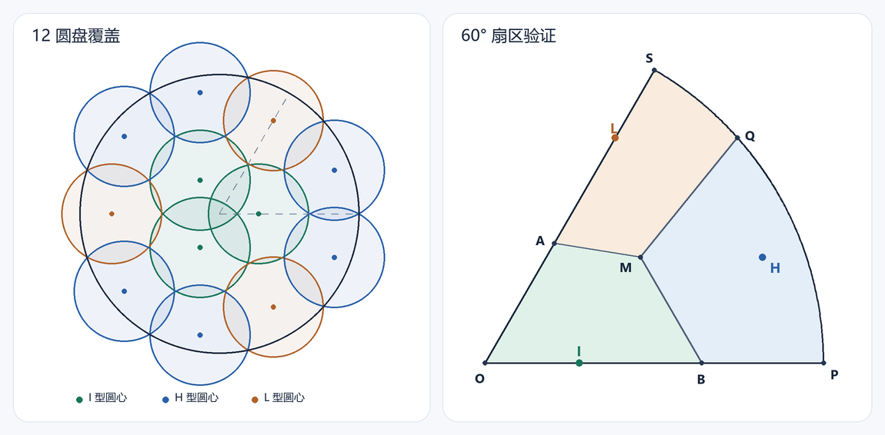

# 十二个等半径圆盘覆盖单位圆盘的全局最优解

最小半径为
\[
\boxed{r_*=0.36110296374450864411\ldots}.
\]
精确值由第 1 节的一元最大值方程定义。经有理区间验证，
\[
0.36110296374450864411<r_*<0.36110296374450864412.
\]
最优构造使用三个内圆心和九个外圆心。下界证明适用于任意配置，使用几何不等式及有限的整数区间搜索。推导和验证均在离线环境完成。

## 1. 精确半径和构造

记半径为 \(r\)、圆心距原点 \(t\) 的圆盘在单位圆周上覆盖的半角为
\[
\alpha_r(t)=\arccos\frac{1+t^2-r^2}{2t}\qquad(1-r\le t\le1+r).
\]
令
\[
a=\frac{u+\sqrt{4r^2-3u^2}}2,\qquad b=u+r,\qquad
F(r,u)=2\alpha_r(\sqrt{b+r^2})+\alpha_r(r+a)-\frac\pi3.
\]
取 \(r_*\) 为 \(0.36110\le r\le0.36111\) 内
\[
\max_{0\le u\le 0.32}F(r,u)=0
\]
的唯一根，取 \(u_*\) 为相应最大点。也可用不含反三角函数的方程确定它们。设 \(v=r+a,\ x=(1+b)/2,\ y=\sqrt{r^2-(1-b)^2/4}\)，则在本文给出的根区间内，\(F=F_u=0\) 等价于 \(J=J_u=0\)，其中
\[
J(r,u)=\frac{x^2-y^2+2\sqrt3\,xy}{2(x^2+y^2)}
       -\frac{1+v^2-r^2}{2v}.
\]

半角 \(\alpha_r\) 关于 \(t\) 凹，且在 \(1-r\le t\le\sqrt{1-r^2}\) 上递增。因为余弦阈值 \(t/2+(1-r^2)/(2t)\) 为正且凸，而 \(\arccos\) 在 \([0,1]\) 上递减且凹。两个代入的圆心距在给定矩形内都处于递增区间，且关于 \(u\) 严格凹。它们随 \(r\) 增大，固定 \(t\) 的半角也随 \(r\) 增大。因此 \(F\) 关于 \(u\) 严格凹，\(\max_uF\) 连续且严格递增。程序 **symmetric.py** 用 \(J\) 的符号和 \(F\) 的切线上界验证了半径区间两端的异号，并用 \(F_u\) 在两端的符号验证
\[
0.27824166087<u_*<0.27824166088.
\]
这里 \(J\) 与 \(F\) 同号且 \(|J|\le |F|\)，由余弦的单调性与 \(1\)-Lipschitz 性直接得到。

在 \(r=r_*,u=u_*\) 处取三个圆心
\[
I=(u,0),\qquad H=(x,y),\qquad L=(r+a)(1/2,\sqrt3/2).
\]
先关于横轴反射，再分别绕原点旋转 \(0^\circ,120^\circ,240^\circ\)，合并重复点后恰有十二个圆心。三个代表圆心为
\[
I\simeq(0.278241660874428,0),\quad
H\simeq(0.819672312309468,0.312853440890865),\quad
L\simeq0.769169019163405(1/2,\sqrt3/2).
\]

只需验证 \(0\le\theta\le60^\circ\) 的扇区。令 \(O=(0,0),P=(1,0),S=(1/2,\sqrt3/2),A=aS,B=(b,0)\)，令
\[
Q=\left(\frac{x^2-y^2}{x^2+y^2},\frac{2xy}{x^2+y^2}\right)
\]
为单位圆周上的接点。令 \(M\) 为三角形 \(IHL\) 的外心。

- \(I\) 圆盘含 \(O,A,B\)。等式 \(\|A-I\|=\|B-I\|=r\) 来自 \(a,b\) 的定义。
- \(H\) 圆盘含 \(B,P,Q\)。其到 \(B,P\) 的距离为 \(r\)，且 \(\arg Q=2\arg H=2\alpha_r(\|H\|)\)。
- \(L\) 圆盘含 \(A,Q,S\)。等式 \(F=0\) 给出 \(\|Q-L\|=r\)。

**symmetric.py** 验证 \(M\) 在扇区内部，并且到三个圆心的共同距离严格小于 \(r\)。弧 \(PQ\) 和 \(QS\) 到各自圆心的最远点都在端点。因此，利用圆盘的凸性，从 \(M\) 向边界各段作线段，可知 \(MAOB\)、\(MBP\widehat{PQ}\) 和 \(MQ\widehat{QS}SA\) 分别由 \(I,H,L\) 的圆盘覆盖。这就验证了整个构造。

## 2. 任意覆盖的归一化和分情形

假设存在一个半径严格小于 \(r_*\) 的覆盖。保持圆心，先把半径增到某个 \(\rho\) 满足
\[
0.361102963\le \rho<r_*.
\]
把单位圆盘外的圆心沿射线投影到单位圆周。这不会增加它到单位圆盘任一点的距离，因为对 \(\|e\|=1,\ \|p\|\le1,\ t>1\)，
\[
\|p-te\|^2-\|p-e\|^2=(t-1)(t+1-2p\cdot e)>0.
\]
再把半径 \(\rho\) 下接触单位圆周且 \(t>\sqrt{1-\rho^2}\) 的圆心移到同射线的 \(t'=(1-\rho^2)/t\)。这保持其单位圆周覆盖弧，同时扩大它在单位圆盘内的覆盖。对半径为 \(s\in(0,1]\) 的同心圆，两者的余弦阈值之差为
\[
\frac{(t-t')(1-s^2)}{2s(1-\rho^2)}\ge0.
\]
两个圆心距均大于 \(\rho\)，原点不影响这一步。归一化后的覆盖仍在半径 \(\rho\) 成立。

取搜索半径 \(R=0.361102964>r_*\)。在归一化的圆心上把半径增至 \(R\)，每个接触单位圆周的圆心距都在 \([1-R,0.933]\) 内。对原本在 \(\rho\) 下接触圆周的圆盘，这是由 \(\sqrt{1-\rho^2}<0.933\) 得到。对新增的圆周圆盘，圆心距至多为 \(1-\rho\)。以下称接触单位圆周的圆盘为外圆盘。

### 排除 11 个或 12 个外圆盘

每个外圆盘覆盖单位圆周的半角至多为 \(\arcsin R<0.370\)，所以至少需要 9 个。12 个全是外圆盘时，没有圆盘含原点。

若恰有 11 个，把半径再扩大到 \(R'=0.361103\)。若外圆盘增至 12 个，已经矛盾。否则剩下的一个内圆盘必须独自覆盖半径 \(1-2R'\) 的同心圆盘，所以它的圆心距 \(t\le3R'-1\le0.084\)。对于每个同心圆，覆盖半角之和至少为 \(\pi\)。把这一不等式乘以非负整数权重并对若干半径求和，可得
\[
\sum_{i=1}^{12}\sum_s w_s\,\beta_{R'}(s,t_i)\ge\pi\sum_s w_s.
\]
这里 \(\beta_r(s,t)=\arccos\bigl(\operatorname{clip}_{[-1,1]}((s^2+t^2-r^2)/(2st))\bigr)\)，\(t=0\) 时按整圆或空弧处理。**exclude11.py** 将 \(0\le t\le0.084\) 分成 14 个区间。对每个区间，脚本验证了一组权重，使一个内圆盘与 11 个外圆盘的加权半角上界严格小于右边。外圆心距范围为 \([1-R',1]\)。每一项上界由余弦阈值的区间极小值和余弦泰勒上界作整数比较得到。所有 14 个比较均为严格不等式。

### 圆周上的锚点

在 \(R\) 下从外圆盘中选出覆盖单位圆周所需的最少圆盘。记其数量为 \(m\)。只剩三类情形。

| \(m\) | 所有外圆盘数 | 剩余圆盘 |
| --- | --- | --- |
| 9 | 9 | 三个内圆盘 |
| 9 | 10 | 两个内圆盘和一个未选外圆盘 |
| 10 | 10 | 两个内圆盘 |

在选中的外圆盘中，令圆盘 0 的圆心距最小，旋转使其位于横轴正向。在 \(m=10\) 时有 \(t_0\le 2R\)。这是因为半径 \(s>R\) 的同心圆上，两个剩余圆盘的半角之和至多 \(2\arcsin(R/s)<\pi\)，所以至少一个选中的圆盘要到达该同心圆，再令 \(s\downarrow R\)。同理，\(m=9\) 时用 \(s>2R/\sqrt3\) 和三个剩余圆盘得到 \(t_0\le R+2R/\sqrt3<0.77807\)。

取八个单位圆周锚点，极角以整周为单位分别为
\[
0.06+\frac{0.88j}{7},\qquad j=0,\ldots,7.
\]
每个半角都小于 \(0.059\) 周。圆盘 0 不能覆盖这些点，且一个圆盘不能覆盖其中两个点。因此可以把覆盖它们的八个选中圆盘依次编号为 1 至 8。每个圆心的极角在对应锚点的 \(0.059\) 周以内，这些角度范围互不相交，故编号顺序就是极角顺序。在 \(m=10\) 时，第十个选中圆盘插入这九个间隙之一。关于横轴反射后，只需枚举间隙 \(0,1,2,3,4\)。间隙 \(j\) 指圆盘 \(j\) 后面的间隙。

在只有 9 个外圆盘的情形，关于横轴反射后可以取 \(t_1\le t_8\)，三个内圆心按极角递增编号为 9、10、11。反射将八个锚点及其编号反序排列。内圆心在原点时可任选极角。

最少圆周覆盖中的弧互不包含。把极角和弧在实轴上按周期展开，弧的左右端点均按圆心极角顺序排列。例如，若一个较早的圆心的弧右端超过较晚者的右端，其左端必在较晚者左端之前，从而包含后者。由此每一对相邻弧必须相接。记相邻圆心极角差为 \(g_{ij}\)，其半角为 \(\alpha_i,\alpha_j\)，则
\[
g_{ij}\le\alpha_i+\alpha_j,\qquad
g_{ij}\ge 2\pi-2\sum_{k\text{ 选中}}\alpha_k+\alpha_i+\alpha_j.
\tag{1}
\]
第二式来自对其余相邻间隙使用第一式。

## 3. 九个外圆盘的一种排列的角度不等式

本节是在半径 \(\rho\) 下的解析证明。考虑第 2 节的第一类情形，即在 \(R\) 下恰有 9 个外圆盘。剩余的三个圆盘在 \(\rho\) 下也不接触单位圆周。由于覆盖单位圆周至少需要 9 个，九个外圆盘在 \(\rho\) 下仍全部为外圆盘，且仍都不可省去。

这九个外圆盘中，按极角非相邻的任意两个圆盘不相交。设两圆心较小极角差为 \(d\)。另一侧至多有六个中间圆心，故式 (1) 给出
\[
d\ge 2\pi-12\arcsin\rho-\alpha_\rho(t_1)-\alpha_\rho(t_2).
\]
若两个圆心距都不小于 \(0.70\)，则 \(d>1.10318\)，中心距离大于 \(1.4\sin(1.10318/2)>2\rho\)。若其中一个圆心距小于 \(0.70\)，其半角小于 \(0.242\)，于是 \(d>1.23118\)，中心距离大于 \(2(1-\rho)\sin(1.23118/2)>2\rho\)。这些严格数字界在 \(\rho\le0.361103\) 下成立，复核脚本用正弦和余弦的有理泰勒界验证它们。

考虑把三个内圆盘编号为 \(I_0,I_1,I_2\) 的下列条件。令 \(u_i\) 为内圆心距，\(d_i\) 为从 \(I_i\) 到 \(I_{i+1}\) 的逆时针极角差，下标模 3。

1. \(u_i\ge0.10\)，且 \(0<d_i<\pi\)。若一对内圆盘至少有一个 \(u<0.14\)，还要求它们的 \(d_i\le2.65\)。因此 \(\sum_i d_i=2\pi\)。
2. 对 \(i=0,1,2\)，取外圆盘 \(3i+1\) 与 \(3i+2\) 的两个圆周交点中较靠内的一点。除这两个圆盘及 \(I_i\) 外，其他圆盘均不含该点。
3. 相邻内圆盘 \(I_i,I_{i+1}\) 的圆周横截相交。取较靠外的交点，除这两个内圆盘及外圆盘 \((3i+3)\bmod 9\) 外，其他圆盘均不含该点。

下面证明满足这些条件的覆盖必有 \(\rho\ge r_*\)。

条件 2 的较靠内交点一定存在且在单位圆盘内部。两相邻外圆周有重叠的单位圆周弧，因此对应小圆盘有一个共同单位圆周点。若两个小圆仅相切，唯一交点会是两个单位圆盘内部圆心的中点，矛盾。两圆心在归一化后距原点至多为 \(\sqrt{1-\rho^2}\)。较靠内交点的平方范数至多为 \(\rho^2+c_i\cdot c_j<1\)，其中严格性来自两圆心极角不同。对条件 3，两个内圆盘的任一交点都在单位圆盘内部，因为内圆心距小于 \(1-\rho\)。

在两个圆周的横截交点处，可从两个圆盘都不包含的一侧趋近该点。两条外法向量之和非零，沿该方向足够小的位移即在两个圆盘之外。其他未包含该点的圆盘也离开一个邻域。由覆盖及闭性，条件 2 的交点必须属于 \(I_i\)，条件 3 的交点必须属于对应外圆盘。

### 每对相邻外圆盘的半角预算

记
\[
\bar\alpha_r(z)=\max_{1-r\le t\le\min(z,1+r)}\alpha_r(t)
\]
并约定 \(z<1-r\) 时为零。它在 \(z\ge1-r\) 时等于 \(\alpha_r(\min(z,\sqrt{1-r^2}))\)，因而在这一范围凹且非递减。记
\[
H_r(u)=2\bar\alpha_r(\sqrt{u+r+r^2}).
\]
这个函数关于 \(u\ge0.10\) 凹，并随 \(r\) 严格增大。凹性来自递增凹函数与凹函数的复合。严格单调性可直接从最大值定义看出，因为 \(r\) 增大时允许的 \(t\) 区间扩大，而且对原来的最大点，半角严格增大。

令 \(b_i=\rho+u_i<1\)，外圆盘 \(3i+1,3i+2\) 的极角差记为 \(g\)。条件 2 给出其共同点距原点至多 \(b_i\)。这两个圆盘还在单位圆周有共同点，故由交集的凸性，它们在半径 \(b_i\) 的同心圆上有共同点。如果 \(t_1,t_2\) 为圆心距，
\[
g\le\min\bigl(\alpha_\rho(t_1)+\alpha_\rho(t_2),
              \beta_\rho(b_i,t_1)+\beta_\rho(b_i,t_2)\bigr).
\]
在弧存在的圆心距区间，\(\beta_\rho(b_i,t)\) 关于 \(t\) 凹，因为 \(b_i>\rho\)。取 \(T=\sqrt{b_i+\rho^2}\)。若 \(T\le\sqrt{1-\rho^2}\)，则
\[
\beta_\rho(b_i,T)=\alpha_\rho(T),\qquad
\left.\partial_t(\alpha_\rho(t)+\beta_\rho(b_i,t))\right|_{t=T}
=-\frac{\rho^2(1+1/b_i)}{T^2\sin\alpha_\rho(T)}<0.
\]
以两圆心距的平均值 \(\bar t\) 代入上界。若 \(\bar t\le T\)，使用 \(4\alpha_\rho(\bar t)\) 的上界。若 \(\bar t\ge T\)，使用 \(2(\alpha_\rho+\beta_\rho)(\bar t)\) 的上界及凹性。两种情形均得
\[
g+\alpha_\rho(t_1)+\alpha_\rho(t_2)\le 2H_\rho(u_i).
\]
若 \(T>\sqrt{1-\rho^2}\)，同一不等式直接由 \(\alpha_\rho\le\arcsin\rho\) 成立。把这三对外圆盘的界与其余六个单位圆周间隙的界相加，得到
\[
\pi\le \sum_i \bigl(H_\rho(u_i)+\alpha_\rho(v_i)\bigr), \tag{2}
\]
其中 \(v_i\) 是条件 3 对应外圆心的圆心距。

### 每对内圆盘的交点预算

令 \(\ell_r(u,v,d)\) 是两个圆心距为 \(u,v\)、极角差为 \(d\in(0,\pi)\) 的半径 \(r\) 圆周的较靠外交点距原点的距离。由于条件 3，\(v_i\le \rho+\ell_\rho(u_i,u_{i+1},d_i)\)。

令 \(w=(u+v)/2\)、\(e=(u-v)/2\)、\(q=w^2\sin^2(d/2)+e^2\cos^2(d/2)\)。由两个圆周交点的中点和垂直偏移公式可得
\[
\ell_r(u,v,d)^2
=r^2+uv\left(\cos d+\sin d\sqrt{\frac{r^2}{q}-1}\right). \tag{3}
\]
在交点存在的范围内，它随 \(r\) 非递减。

以下是对半径 \(r_*\) 的一个两变量区间不等式。记 \(d_0=2\pi/3\)，
\[
h_r(w,d)=w\cos(d/2)+\sqrt{r^2-w^2\sin^2(d/2)},\qquad
K_r(w,d)=H_r(w)+\bar\alpha_r(r+\max(r,h_r(w,d))).
\]
取 \(\lambda=\partial_d K_{r_*}(u_*,d_0)<0\)。由于 \(F=F_u=0\)，\(K_{r_*}(u_*,d_0)=\pi/3\)，且其 \(w\) 偏导为零。对本节允许的 \(u,v,d\)，若两圆周相交，则
\[
H_{r_*}(w)+\bar\alpha_{r_*}\bigl(r_*+\ell_{r_*}(u,v,d)\bigr)
\le \pi/3+\lambda(d-d_0). \tag{4}
\]
程序 **balanced.py** 通过以下区间界验证式 (4)。

- \(d\le1.4\) 时，左边至多 \(3\arcsin r_*\)，而该数小于右边在 \(d=1.4\) 的值。
- \(1.4\le d\le2.35,\ 0.10\le w\le0.37\) 时，左边至多 \(K_{r_*}(w,d)\)。若交点半径 \(s\le r_*\)，用 \(\max(r_*,h)\) 即可。若 \(s>r_*\)，由 \(\beta_{r_*}(s,t)\) 的凹性可得 \(d\le2\beta_{r_*}(s,w)\)，解得 \(s\le h_{r_*}(w,d)\)。程序分别验证带 \(h\) 的项和带 \(r_*\) 的项。对带 \(h\) 的项，在含切点的矩形内验证 Hessian 负定，因而切平面给出上界。其余矩形用中点函数值加偏导绝对值上界乘以半边长来验证严格不等式。
- \(w\ge0.37,\ 1.4\le d\le2.35\) 时，先用 \(H\le2\arcsin r_*\)。对 \(d\le1.6\)，交点到两条圆心射线之一的距离至少为 \(s\sin(d/2)\)，故 \(s\le r_*/\sin(d/2)\)。对 \(d\ge1.6\)，若 \(s>r_*\)，上一条的凹性论证仍给出 \(s\le h_{r_*}(w,d)\)。这个函数在 \(w\ge0.37\) 的定义域上递减，因为它关于 \(w\) 的最大点为 \(r_*\cot(d/2)<0.37\)。因此 \(s\le\max(r_*,h_{r_*}(0.37,d))\)。这两个一变量上界用有理区间比较。
- \(d\ge2.35\) 时直接用式 (3)。此时 \(w\le r_*/\sin(2.35/2)<0.394\) 是相交的必要条件。式 (3) 中括号内的量至多
  \[
  C(w,d)=\cos d+\sin d\sqrt{r_*^2/(w^2\sin^2(d/2))-1}.
  \]
  在该角度区间及其定义域，\(C\) 关于 \(w,d\) 都递减。若两圆心距都至少为 \(a\)，则 \(2wa-a^2\le uv\le w^2\)。对每个小矩形先取 \(C\) 的上界，按上界的正负选择 \(uv\) 的上界或下界，即得式 (3) 的上界。程序验证了 \(a=0.10,\ 2.35\le d\le2.65\) 和 \(a=0.14,\ 2.35\le d\le\pi\) 两个区域。

所有区间比较使用向外取整的定点整数算术。余弦用泰勒上下界，平方根用整数平方根，反余弦的端点通过余弦比较复核。切平面中的 \(r_*,u_*,\pi,\lambda\) 也使用经验证的区间。

现在假设 \(\rho<r_*\)。由 \(H_r\) 随 \(r\) 严格增大及其关于圆心距的凹性，每对内圆盘有
\[
\frac{H_\rho(u_i)+H_\rho(u_{i+1})}{2}<H_{r_*}(w_i).
\]
由式 (3) 的单调性及 \(\bar\alpha\) 的定义，
\(\alpha_\rho(v_i)\le\bar\alpha_{r_*}(r_*+\ell_{r_*}(u_i,u_{i+1},d_i))\)。
把式 (4) 对三对内圆盘求和。因 \(\sum d_i=2\pi\)，式 (2) 的右边严格小于 \(\pi\)，矛盾。这一排除只用三组交点的归属条件，允许非对称圆心和圆盘排列的连续变化。

## 4. 有限搜索的完备性

**anchored_search.cpp** 对第 2 节的全部情形作有限枚举。以下给出枚举的必要条件、分支规则和叶节点证明。枚举中使用的半径、角度、圆心区间和排除比较都可以复算。

### 极坐标区间与传播

以 \(10^9\) 为长度单位分母，以 \(1008000000\) 为一周的角度单位。把角度分成 720 个闭区间，把一般外圆心距分成 96 个闭区间，内圆心距分成 192 个闭区间，把固定方向的圆盘 0 的圆心距分成 48 个闭区间。区间边界按整数向下取整，首尾端点保持不变。每个圆心允许的极坐标单元格是这两类区间的笛卡尔积。锚点、插入间隙和圆盘类别决定初始单元格集合。

**exact_angles.py** 为每个半径与圆心距区间给出覆盖半角的整数上界。余弦阈值的极小值在端点或 \(t=\sqrt{s^2-R^2}\) 处。先对阈值取有理下界，再对候选半角用余弦的有理泰勒上界进行比较。只有比较通过才采用该半角，故浮点初值不影响正确性。**exact_directions.py** 同样给出每个角度区间的正弦、余弦上下界，用于叶节点的笛卡尔区间。

枚举检查 30 个同心圆上的 11160 个见证点。每个见证点的极角也是整数角度单位。一个单元格可能覆盖见证点，必须满足见证点极角到单元格角度区间的圆周距离不大于覆盖半角上界。在单位圆周上的见证点只允许选中的外圆盘负责，因为这些圆盘按定义已覆盖单位圆周。枚举还使用以下连续必要条件。

- 圆盘 0 的圆心距不大于其余选中圆盘的圆心距。
- 式 (1) 对每一对选中的相邻圆盘成立。左右端点的可达区间和其他半角的上界给出必要的单元格筛选。
- 若干同心圆上的半角上界之和至少为半周。某个圆盘的某个单元格若加上其余圆盘当前可取的最大半角仍不足半周，即可删除。

如果一个见证点只能由一个圆盘的某些单元格覆盖，删除该圆盘的其余单元格。如果没有任何圆盘可能覆盖该点，该分支矛盾。否则取一个尚未保证覆盖的见证点，对负责覆盖它的圆盘分支。每个分支把相应圆盘的单元格限制到可能覆盖该点的集合。后续分支可排除已经枚举过的圆盘负责该点的可能性，因为前一分支已包含所有这些情况。两个未锚定圆盘的类别与当前单元格集合完全相同时可交换编号，只需枚举其中一个等价分支。以上传播、分支及对称约简保留了所有真实覆盖。

### 识别第 3 节的排列及叶节点复核

对恰有 9 个外圆盘的情形，计算每个圆心当前允许单元格的笛卡尔区间外包。程序 **refine_geometry.hpp** 用这些区间识别第 3 节的条件。

1. 枚举三个内圆盘的编号，检查圆心距与三个逆时针角差。可以直接用极角区间，也可以用区间叉积为正及归一化点积的余弦界。角度上界 \(2.65\) 的常数由 **balanced.py** 复核。
2. 对指定的每对相邻外圆盘，其他外圆盘因第 3 节的非相邻圆盘分离性质而不能包含交点。对不指定的内圆盘，若它与这一对中至少一个圆盘分离，则也不能包含交点。分离由两圆心区间距离大于 \(2R\) 验证。若这一测试不足，则用交点公式的区间外包，检查到该内圆心的最小距离是否大于 \(R\)。
3. 对指定的每对内圆盘，用交点公式验证横截相交并取较靠外交点的区间外包。逐个排除其余圆盘，方法为与一对中的任一个圆盘分离，或者其圆心区间到交点区间的最小距离大于 \(R\)。

第 3 步也可用内三角形的锐角条件。若三个内圆心均距原点小于 \(\rho\) 且构成锐角三角形，其外接半径小于 \(\rho\)，因为锐角三角形的外接圆盘是最小外接圆盘。其外心因此位于任一内圆心对的两交点之间。按三个内圆心的逆时针顺序定向一条边，第三个圆心在左侧，较靠外的交点在右法向方向。沿边的垂直平分线从外心走向该交点，到第三圆心的平方距离与到边端点的平方距离之差从零严格增大。因此第三个内圆盘不含较靠外交点。其他外圆盘用分离测试排除。

交点区间用真实半径范围 \([0.361102963,R]\) 计算。识别成功即由第 3 节排除半径 \(\rho<r_*\) 的覆盖。

搜索开始前还直接验证了一组覆盖候选构造附近的乘积区间。三个内圆心距在 \([0.23,0.33]\)，极角距 \(1/6,1/2,5/6\) 周各至多 \(0.025\) 周。三个编号为 \(0,3,6\) 的外圆心距至少为 \(0.72\)，其极角距 \(0,1/3,2/3\) 周各至多 \(0.04\) 周，其中圆盘 0 的极角固定为零。其余六个外圆心距至少为 \(0.78\)，极角距 \(0.1086,0.2247,0.4420,0.5580,0.7753,0.8914\) 周各至多 \(0.05\) 周。**exact_directions.py** 逐对复核相应的分离测试。所用界是极角差至少 \(72^\circ\) 时到半径 \(0.78\) 处圆心的距离至少 \(0.78\sin72^\circ>2R\)，以及极角差至少 \(90^\circ\) 时平方距离至少 \(0.72^2+0.23^2>4R^2\)。

这个乘积区间内，内圆心的相邻极角差在 \(102^\circ\) 到 \(138^\circ\) 之间。对于圆心距为 \(a,b,c\) 的内三角形，在对应 \(a\) 的顶点，向量点积至少为 \(a^2+0.207a(b+c)-0.744bc\)。先取 \(a=0.23\)，再对 \(b,c\) 检查四个端点组合，得到严格正值。三角形因此为锐角，上述外心论证适用。整个乘积区间都由第 3 节排除。枚举只需按第一个超出该乘积区间的单元格所属圆盘作分支。每个完全位于乘积区间的单元格组合已由这一证明处理。

如果全部离散见证点已在松弛约束下覆盖，但还无法识别该排列，则在笛卡尔区间上进一步验证。程序从当前区间中点配置提出圆盘内的有理见证点，然后用整数比较验证该点确实在单位圆盘内。若每个圆心区间到此点的最小平方距离都超过 \(R^2\)，该叶节点被排除。若只有一个圆心区间有可能覆盖它，就用圆盘约束缩小该区间。进一步分支时，按可能负责覆盖该点的圆盘枚举，或把一个坐标区间二分。区间缩小使用向外取整的整数平方根，二分覆盖原区间。浮点运算只负责提出见证点和给分支排序。真正的排除都经过整数距离比较或第 3 节的区间识别。

### 运行结果

在本目录运行 **python verify_global.py** 可重新生成整数界并复核全部分支。需要 Python 3 和支持 C++20 与 128 位整数的 GCC 或 Clang。程序输出每一类的搜索节点数和验证状态。没有通过检验的叶节点会导致程序报错。

本次复跑验证了 2301 个 Hessian 区间和 4936 个支撑平面区间。下表中半径分箱的下标从 0 开始，分箱编号区间的右端不计入。每个分箱本身是闭区间。

| 分支 | 搜索节点 | 结果 |
| --- | ---: | --- |
| 10 个外圆盘均为圆周覆盖所需，间隙 0 | 10 | 排除 |
| 同上，间隙 1 | 33 | 排除 |
| 同上，间隙 2 | 94 | 排除 |
| 同上，间隙 3 | 289 | 排除 |
| 同上，间隙 4 | 7,096 | 排除 |
| 10 个外圆盘中有 1 个可从圆周覆盖省去 | 76 | 排除 |
| 9 个外圆盘，圆盘 0 的分箱下标在 \([0,12)\) | 4 | 排除 |
| 同上，\([12,24)\) | 539 | 排除 |
| 同上，\([24,36)\) | 208,568 | 排除 |
| 同上，\([36,40)\) | 155,140 | 排除 |
| 同上，\([40,44)\) | 123,050 | 排除 |
| 同上，\([44,48)\) | 134,350 | 排除 |

合计 629,249 个极坐标搜索节点。在最后一个区间中，11,417 个叶节点还执行了笛卡尔区间复核，全部通过。复跑记录见 **verification.txt**。

由第 2 节，任意假设的较小半径覆盖都属于枚举中的一个情形。第 4 节排除了这些情形中的每一个，而第 1 节给出了半径 \(r_*\) 的覆盖。因此 \(r_*\) 是全局最小半径。
