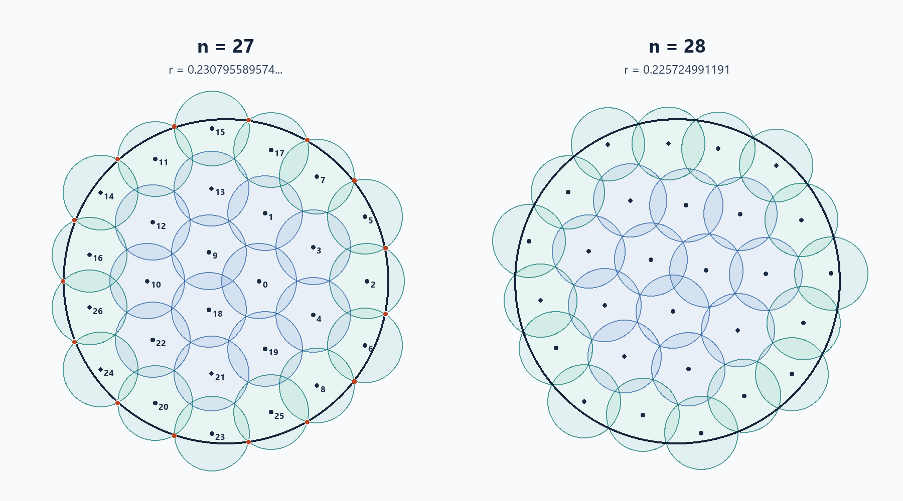

# 单位圆盘覆盖接力 · 27 与 28

记 \(r_D(n)\) 为覆盖闭单位圆盘所需的 \(n\) 个等半径闭圆盘的最小半径。本次证明给出

\[
0.224410\le r_D(27)\le \rho_{27},\qquad
0.220001\le r_D(28)\le 0.225724991191 ,
\]
\[
0.230795589574191436708192288037835382313555924493258750321853
<\rho_{27}<
0.230795589574191436708192288037835382313555924493258750321854.
\]

\(\rho_{27}\) 有下文的精确代数构造。该构型在全部 53 个去旋转自由度中有严格局部最优性，并有半宽 \(10^{-6}\) 的已验证捕获盒。两个 \(n\) 的全局最小值仍未确定。



## 1. \(n=27\) 的精确构造

下文计算使用坐标 \((x,y)\) 代表物理点 \((x,\sqrt3\,y)\)。记
\(\|a\|^2=a_x^2+3a_y^2\)，\([a,b]=a_xb_y-a_yb_x\)。令 \(t=\rho_{27}^2\)。首组九个中心依次为

\[
(u,0),\ (v/2,v/2),\ (h,0),\ (m_x,\pm m_y),\
(p_x,\pm p_y),\ (q_x,\pm q_y).
\]

每个 \(\pm\) 先取正。对全组再旋转 \(120^\circ\) 和 \(240^\circ\)，按组编号 \(0,\dots,26\)。在上述坐标里 \(120^\circ\) 旋转是 \((x,y)\mapsto (-(x+3y)/2,(x-y)/2)\)。六个代表点的物理坐标约为

| 代表 | 横坐标 | 纵坐标 |
|---|---:|---:|
| \(u\) | 0.205284437320179 | 0 |
| \(v\) | 0.240306146578898 | 0.416222455245745 |
| \(h\) | 0.866445038283632 | 0 |
| \(m\) | 0.535864737801906 | 0.208109624083074 |
| \(p\) | 0.853139333161419 | 0.394273910339165 |
| \(q\) | 0.558801222758269 | 0.642846058035261 |

精确中心由以下八个接触和十个驻点方程定义。对三角形中心 \(a,b,c\) 写

\[
P_{abc}=\|b-a\|^2\|c-a\|^2\|c-b\|^2-12t[b-a,c-a]^2 .
\]

其为零等价于外接圆半径平方等于 \(t\)，前提是三中心不共线。对边界相邻中心 \(a,b\)，令 \(h_a=1+\|a\|^2-t\)、\(h_b=1+\|b\|^2-t\)，并写

\[
P_{ab}=3(h_a b_y-h_b a_y)^2+(a_x h_b-b_xh_a)^2-12[a,b]^2 .
\]

令 \(z\) 解 \(2z\cdot a=h_a,\ 2z\cdot b=h_b\)，点积按物理坐标计算。在 \([a,b]\ne0\) 时，\(P_{ab}=12[a,b]^2(\|z\|^2-1)\)。故方程 \(P_{ab}=0\) 给出同时在单位圆和两个小圆上的边界锚点。

五个中心三角形代表为 \((0,9,1),(0,3,4),(2,3,4),(3,1,7),(3,5,7)\)。三个边界对代表为 \((2,5),(5,7),(7,17)\)。把对应多项式限制在首组变量的九维构型空间及 \(t\) 上，化成首项系数为正的本原整式 \(g_j\)。取 \(g_j=0\) 及 \(\sum_j\mu_j\nabla g_j=\nabla t\)。

程序从几何公式重建 18 个整数多项式并与证书逐项比对。设多项式向量为 \(F\)，证书给出有理中点 \(z_0\) 和预条件矩阵 \(B\)。对半宽 \(10^{-74}\) 的闭盒 \(X\)，用有理区间验证 \(z\mapsto z-BF(z)\) 严格自映入且为压缩映射。导数检验也推出 \(B\) 可逆。盒内唯一不动点即方程组的唯一根。上面的半径界由 \(t\) 的有理端点及整数平方比较得到。

### 连续覆盖

证书给出 37 个有向中心三角形，其有向边和恰为一条 15 中心边界环。21 个面的外接半径由接触等式给出，其余 16 个严格小于 \(\rho_{27}\)。若三角形的顶点 \(c_i\) 都距某个点 \(w\) 至多 \(\rho_{27}\)，对三角形内 \(x=\sum_i\lambda_i c_i\) 有

\[
\sum_i\lambda_i\|x-c_i\|^2
=\sum_i\lambda_i\|w-c_i\|^2-\|x-w\|^2
\le \rho_{27}^2.
\]

所以各中心三角形被覆盖。每条边界环边的锚点同时在相邻两盘内，两盘也包含该中心边的中点。用中点把锚点与中心边的连接三角形一分为二，两半分别在对应小盘内。另在每个边界中心和其两个相邻锚点之间加三角形，它在该小盘内。把所有三角形取一致的边界方向相加，内部边逐条抵消，剩下锚点多边形的有向边界。

验算器检验相邻锚点的叉积与点积均为正。相邻锚点的转角至多 \(2\arcsin\rho_{27}<\pi/5\)，因为同属一个小盘。15 次转角之和为 \(2\pi\) 的正整数倍且小于 \(4\pi\)，故锚点沿单位圆恰转一周。任一点若在锚点多边形内部、又不在任一已覆盖三角形中，各三角形边界对它的绕数都为零，与总绕数为一矛盾。闭性给出多边形边界。最后，每段锚点间的短圆弧在相应小盘内，其凸包是对应圆弓，也在同一小盘内。多边形与这些圆弓铺满闭单位圆盘。

## 2. \(n=27\) 的定量局部证明

固定 \(t=\rho_{27}^2\)，让 27 个圆心独立变化，只将编号 2 的纵坐标固定为零。设 \(X_{\rm loc}\) 是以精确构型为中心、其余 53 个坐标各自半宽 \(10^{-6}\) 的闭盒。以下接触不等式在整个盒上成立。

- 对 21 个中心三角形，移动外接圆心仍在单位盘内，且不在其余 24 个半径 \(\rho_{27}\) 的盘内。若小盘覆盖了单位盘，该点必由三位等距中心覆盖，因此 \(P_{abc}\le0\)。
- 对 15 个边界对，取其移动垂直平分线与单位圆的两个交点中延续原锚点的一支。该点等距于两中心，并与其余盘严格分离。若覆盖成立，两中心都覆盖它，因而它满足 \(2x\cdot a\ge h_a,\ 2x\cdot b\ge h_b\)。验算器核对线性方程定义的 \(z\) 在 \(a,b\) 的正锥内。取正线性组合得 \(x\cdot z\ge\|z\|^2\)，所以 \(\|z\|\le1\) 且 \(P_{ab}\le0\)。

把这 36 个原始接触多项式记为 \(P_i\)。程序核对每一轨道和符号、比例 \(g_j=s_iP_i|_{\rm sym}\)。令 \(\lambda_i=-\mu_j s_i/|\mathcal O_j|\)，有理区间证实所有 \(\lambda_i>0\)。驻点方程给出 \(\sum_i\lambda_i\,dP_i=0\) 在对称构型空间上的限制。这个协向量在 \(D_3\) 下不变，对任意向量的作用等于它对群平均向量的作用。固定子空间正是首组三重旋转和镜像参数描述的空间，故协向量在全部 54 个坐标中为零。

对证书中明确的正有理数 \(k_i\) 定义

\[
E=\sum_i\left(\lambda_i P_i+\frac{k_i}{2}P_i^2\right).
\]

根处 \(P_i=0\)，因而 \(E=0,\ dE=0\)。在整个盒内严格验算 \(|k_iP_i|<2\lambda_i\)。所以若能以半径 \(\rho_{27}\) 覆盖，所有 \(P_i\le0\) 推出 \(E\le0\)。另对完整 Hessian

\[
D^2E=\sum_i\big((\lambda_i+k_iP_i)D^2P_i+
k_i\,dP_i(dP_i)^{\mathsf T}\big)
\]

用因式形式、乘积求导和有理区间包络。利用 \(P_i\) 在根处为零，再以均值估计收紧它在盒中的范围。证书用有理矩阵 \(Y\) 验证 \(Y D^2E\,Y^{\mathsf T}\) 对称且处处有正对角元和严格对角占优。该性质也推出 \(Y\) 可逆，所以 \(D^2E\) 在整个凸盒上正定。沿根到任何非根点的线段积分，得到 \(E>0\)。这与覆盖的必要条件矛盾。

编号 2 的横坐标正，故任一充分接近的有标签构型可整体旋转进上述盒。盒中唯一可用不超过 \(\rho_{27}\) 的半径完成覆盖的构型是该根。这个局部证明的变量允许破坏全部镜像和旋转对称。

## 3. 任意构型的面积下界

取测试半径 \(U\)。假设某构型能以半径 \(r<U\) 覆盖。若某圆心 \(\|c\|>\sqrt{1-U^2}\)，取 \(\lambda=(1-U^2)/\|c\|^2\)，用 \(\lambda c\) 替代它。恒等式

\[
\|x-\lambda c\|^2-U^2
=\lambda(\|x-c\|^2-U^2)+(1-\lambda)(\|x\|^2-1)
\]

保持单位盘内原先被其严格覆盖的点。紧致性允许再作一般位置微扰并保持严格覆盖，且令各中心范数小于 \(\sqrt{1-U^2}\)。取中心互异、任意三点不共线、任意四点不共圆，且单位圆上无三个最近中心同时并列。

两个中心的垂直平分线距原点小于 \(\sqrt{1-U^2}\)，它在单位圆上截得的弦长大于 \(2U\)。每个拥有单位圆上一段最近区域的中心都只能拥有一段圆弧。若拥有区域在其盘内的短圆弧上分离，中间严格更近的中心的垂直平分线将在该短弧上相交两次，弦长至多 \(2U\)。一般位置排除只拥有孤点。设有 \(b\) 个边界拥有者，其弧半角 \(t_i\) 满足 \(0<t_i\le\arcsin U\) 及 \(\sum_i t_i=\pi\)。

每位拥有者的中心范数至少 \(1-U\)，其盘不能覆盖开核心盘 \(\|x\|<1-2U\)。该核心盘及其边界因此由其余盘覆盖，边界部分用闭性。令 \(q=U/(1-2U)\)。验算 \(q<\sin(\pi/7)<1/2\)。核心边界需要至少八个盘，而一个覆盖原点的核心用盘不接触核心边界，所以至少九个非边界拥有者。两组测试参数的 \(b\) 分别满足 \(14\le b\le18\) 和 \(15\le b\le19\)，下端用 \(U<\sin(\pi/13)\) 或 \(U<\sin(\pi/14)\)。同一个计数论证在 \(n=27,\ U=0.230796\) 也给出 \(14\le b\le18\)。

### Voronoi 面积与分组

截断各中心的 Voronoi 胞于单位圆盘。在每个胞内从中心向各公共边的内部选点以及边界切换点连线。合并公共边两侧的线为抽象中心边，合并一般位置的内部 Voronoi 顶点周围的三个区域为中心三角面。每个边界切换点处有一个切换三角面，另有 \(b\) 个拥有者与各自弧的两端点形成的弯边面。公共边不会有两个单位圆端点，因为两端点都由相同两个盘覆盖却相距大于 \(2U\)。所以每个切换面沿中心边与恰一个中心三角面相邻。

这个抽象剖分有 \(n+b\) 个顶点、\(b\) 条外边，Euler 公式给出 \(2n+b-2\) 个三角面。扣去 \(2b\) 个带切换点的面，剩 \(2n-b-2\) 个中心三角面。它们分别在以内部 Voronoi 顶点为中心的半径 \(U\) 的盘内。切换面的两条小盘半径边不长于 \(U\)。将抽象面映成实际中心和切换点的有向三角形，有向内部边两两抵消，面积和为切换点多边形的面积。加上弧的圆弓面积便得 \(\pi\)。中心面与切换面使用绝对面积上界，拥有者面保留符号。

弧半角为 \(\theta\) 时，令 \(s=\sin\theta,\ c=\cos\theta,\ h=\sqrt{U^2-s^2}\)。在弧中点的径向和切向坐标中，拥有者为 \((c-h+x,y)\)，且

\[
0\le x\le2h,\qquad 2s|y|\le 2hx-x^2 .
\]

拥有者有向三角面与弧的圆弓合计 \(G(\theta)-sx\)，其中 \(G(\theta)=\theta-sc+sh\)。有 \(G'=2s^2+c(U^2-2s^2)/h\)，并且

\[
\frac{h^3G''}{s}=4ch^3-U^4-3U^2+6U^2s^2+2s^2-4s^4
\le U^2(5U^2-1)<0.
\]

上界用 \(ch^3\le U(U^2-s^2)\)、\(4U-6U^2-2<0\) 和 \(s^2\le U^2\)。故 \(G\) 在闭域上凹。选定切点 \(d\)，设
\(J(\theta)=G(d)+G'(d)(\theta-d)-G(\theta)\)。
它凸且在 \(d\) 最小为零。拥有者总面积贡献为

\[
b\bigl[G(d)+G'(d)(\pi/b-d)\bigr]-\sum_i R_i,\qquad
R_i=J(t_i)+\sin(t_i)x_i .
\]

将 \(R_i\) 平分给其两条边界环边。把各切换面分给其相接的中心三角面，每组于是含零、一或两条环边。一组的基准面积是 \(AU^2\) 加每条环边 \(U^2/2\)，其中 \(A=3\sqrt3/4\) 是单位盘内最大三角形面积。组的亏损是基准减绝对面积上界，再加上所获的 \(R_i\) 份额。

一边组的两面积之和至多 \(U^2 f(z)\)，其中 \(z\) 是该边长除以 \(U\)，\(f(z)=z/2+z\sqrt{1-z^2/4}\)。两个共同见证到边线的距离至多 \(U\sqrt{1-z^2/4}\)，中心面的高还可增加 \(U\)，给出此式。Young 不等式 \(2zw\le(37/100)z^2+(100/37)w^2\) 用于 \(w=\sqrt{1-z^2/4}\)，配方得 \(f\le147325/83694\)。所以其原始亏损严格大于 \(e_0U^2\)，其中 \(e_0=0.0387\)。

两边组将半径缩为 1，设两环边长 \(z_1,z_2\)，另一边长 \(z_3\)，\(v=z_1^2+z_2^2\)。共同见证至三个顶点皆不远于 1。取第三边中点 \(m\) 与半边向量 \(w\)，有 \(\|m\|^2+\|w\|^2\le1\) 及 \(\|w\|^2=z_3^2/4\)，原点在见证处，故 \(v\le4+4\sqrt{1-z_3^2/4}\)。若 \(v\le4\)，三角形面积至多 1，两切换面的面积和至多 1。若 \(v\ge4\)，得到 \(z_3^2\le2v-v^2/4\le v\)。Heron 恒等式和 \(4z_1^2z_2^2\le v^2\) 给出中心面面积至多 \(v\sqrt{v(8-v)}/16\)，Cauchy–Schwarz 给出切换面面积和至多 \(\sqrt{v(8-v)}/4\)。合计

\[
F(v)=\frac{(v+4)\sqrt{v(8-v)}}{16}
\]

在 \(v=2+2\sqrt3\) 达最大，最大值的平方为 \(9/4+3\sqrt3/2\)。两段上界都小于 \(2.202\)，所以两边组原始亏损严格大于 \(0.097U^2\)。

### 精确角盒

对每个 \(b\) 选择有理 \(e\ge e_0\)，验证每组总亏损至少为环边数乘 \(eU^2\)。若一边组两端的 \(R_i\) 和至少 \(2(e-e_0)U^2\)，或两边组的加权和至少 \((2e-0.097)U^2\)，原始亏损已够。剩余情形由 \(J\) 的凸性和窗口两端的严格下界约束在相应闭角窗口内。

两个相邻弧的中点径向在角平分线坐标中与第一轴夹角 \(\pm q\)，其中 \(q=(t_1+t_2)/2\)。令 \(a_i=\cos t_i-\sqrt{U^2-\sin^2t_i}\)，它随 \(t_i\) 增加。两个理想圆心的坐标差的绝对值不超过 \(|a_2-a_1|\cos q\)、\((a_1+a_2)\sin q\)。给定正权重 \(\omega_i\) 及 \(w=\sum_i\omega_i s_i x_i\)，实际差的两个坐标上界各可增添 \(w\) 乘以下系数

\[
\max_i\frac{\cos q+(h_i/s_i)\sin q}{\omega_i s_i},
\qquad
\max_i\frac{\sin q+(h_i/s_i)\cos q}{\omega_i s_i}.
\]

这是 \( |y_i|\le h_ix_i/s_i\) 及旋转投影的直接结果。盒端点给出这些非负量的有理上界。故归一化边长上界 \(L(w)\) 为两个非负仿射函数的 Euclidean 范数除以 \(U\)，是凸函数。

对一边组取 \(\omega_1=\omega_2=1\)。扣去盒上两个 \(J\) 的下界和 \(J_0\)，剩余预算 \(W=2(e-e_0)U^2-J_0\)。当 \(W<0\) 时整盒已够。否则对凹函数 \(f\) 取斜率 \(D>0\) 的切线 \(f(z)\le f(z_0)+D(z-z_0)\)。为了证明亏损大于 \(eU^2\)，可在 \(0\le w\le W\) 上最大化 \(f(z_0)+D(L(w)-z_0)-w/(2U^2)\)。它凸，程序只检查两端。

对两边组，三个拥有者的权重为 \((1/2,1,1/2)\)。每条边使用相应两项的权重及全组的非负剩余预算 \(W\)，给出边长上界 \(X,Y\)。一种亏损下界是 \(A-XY/2+J_2/U^2\)，其中 \(J_2\) 是三项 \(J\) 的加权下界。还可在 \(\bar v=\max(4,X^2+Y^2)<2+2\sqrt3\) 时利用 \(F\) 的单调性，得到 \(A+1-\max(2,F(\bar v))+J_2/U^2\)。每盒有其中一个界大于 \(2e\) 即通过。

所有角盒检查均从完整闭窗口出发，分割时保留两个闭子盒。超出预算的盒由 \(J\) 单独排除。算术为 BigInt 向外舍入、Machin 公式和有余项界的交错级数。相加后必须有

\[
\pi\le(2n-b-2)AU^2+b(1/2-e)U^2+
b\bigl[G(d)+G'(d)(\pi/b-d)\bigr].
\]

程序对每个可行 \(b\) 严格证实右端小于 \(\pi\)，在 \(n=27\) 取 \(U=0.224410\)，在 \(n=28\) 取 \(U=0.220001\)。由于排除了 \(r<U\)，得到两条无条件下界。

## 4. \(n=27\) 的 14 边界拥有者分支

在测试半径 \(U_1=0.230796\) 下，记 \(T=0.233>\arcsin U_1\)。任一拥有者的中心极角与其弧中点的差至多 \(T-t_i\)。当 \(b=14\)，任一对非相邻拥有者之间按任一方向均至少包含三段弧（计入两端弧）。计入两端中心可能的偏转，中心极角差在两方向都至少为 \(2(\pi-12T)\)。相邻极角差也为正，使用 \(2(\pi-13T)>0\)。于是非相邻边界中心距离至少 \(2(1-U_1)\sin(\pi-12T)>2U_1\)。它们不会相邻于截断 Voronoi 对偶图。每位边界拥有者的度 \(d\) 因而满足 \(3\le d\le15\)。若度为 2，其唯一相接中心三角形会把两位非相邻边界拥有者相连。

在同一测试半径下，任取一条避开 Voronoi 顶点的射线，从单位圆向内走，首次离开边界拥有者的胞时会进入与其共边的内部胞。穿越点的范数至少 \(1-2U_1\)，因为它仍在原拥有者的小盘中。每个能接住这种穿越点的内部盘，能接住的射线角域长度至多 \(2\arcsin(U_1/(1-2U_1))<2\pi/7\)。各角域须覆盖全圆周，所以至少八个不同的内部胞与外圈相邻。若 \(b=14\)，按环顺序拼接每个边界拥有者扇面里的内部邻居路径，得到访问这至少八个顶点的闭游走。边界拥有者 \(i\) 的内部邻居数为 \(d_i-2\)，贡献 \(d_i-3\) 步，因此 \(\sum_i d_i\ge 50\)。

进一步取测试半径 \(U=0.2288\)。设某边界拥有者的弧半角为 \(\theta\)，它的截断胞以弦代弧后为 \(d+1\) 边形，仍包含中心。所有顶点到中心的距离至多 \(U\)，弦对中心的张角 \(\alpha\) 满足 \(\alpha\ge 2\arcsin(\sin\theta/U)\)。这里 \(\sin\theta>U/2\) 由 \(b=14\) 和半角总和得出。具体而言，在固定张角 \(\alpha\) 时，两条半径在 \([0,U]\) 变动可得的最大弦长为 \(\max(U,2U\sin(\alpha/2))\)。其余 \(d\) 扇角的和为 \(2\pi-\alpha\)，由正弦的凹性得到整个多边形的面积上界

\[
\frac{U^2}{2}\bigl(\sin\alpha+d\sin((2\pi-\alpha)/d)\bigr).
\]

这个表达式在 \(\alpha=2\pi/(d+1)\) 达最大，其后单调下降。加上圆弓得到该胞面积。内部度 \(d\) 胞的面积上界为 \(U^2d\sin(2\pi/d)/2\)。

验算器用闭半角区间比较边界胞面积与 \(\theta+\lambda\theta+\mu d+C_b\)，比较内部胞面积与 \(\mu d+C_i\)。有理系数分别为 \(\lambda=-2.24874,\ \mu=0.008857,\ C_b=0.34636,\ C_i=0.08287\)。对偶图度数和是 \(6n-2b-6=128\)。所有比较及 \(\lambda\pi+128\mu+14C_b+13C_i<0\) 严格成立，故 \(r<0.2288\) 的覆盖无法在测试半径 \(0.2288\) 的一般位置归一化后得到 14 个边界拥有者。

## 5. \(n=28\) 的有理构造

`cover-28-rational.json` 给出物理坐标下的 28 对有理圆心以及半径 \(0.225724991191\)。验证器在每个截断 Voronoi 胞上考虑到圆心的平方距离。该函数凸，故直边上的最大值可推到端点。内部顶点来自三个中心的垂直平分线，圆周上各弧的端点来自一对中心的垂直平分线。圆弧内部的极值在圆心方向或反方向，中心为原点时函数恒定；程序也检查 \((1,0)\)，以处理没有端点的整圆。程序允许额外的非 Voronoi 候选点，并逐个给出至少一个距离严格小于测试半径的盘。计算用有理数和整数平方根外包，从而证明整个闭圆盘被覆盖。

## 6. 重放

从本目录运行以下命令。Python 检验器需要 SymPy 1.14。Node.js 检验器只使用自带模块。

```powershell
python -B verify_cover27.py exact-27
python -B verify_local27.py exact-27
node area27.js 27
node verify_boundary14.js
node area27.js 28
python -B verify_rational_cover.py cover-28-rational.json
```

证明缺口是把 \(n=27\) 测试半径内的任意归一化覆盖排除，或将它经标号和旋转送入第 2 节的已认证盒。14 至 18 个边界拥有者都仍有未排除的范围。\(n=28\) 已证两侧界，尚需相接的全局下界。
