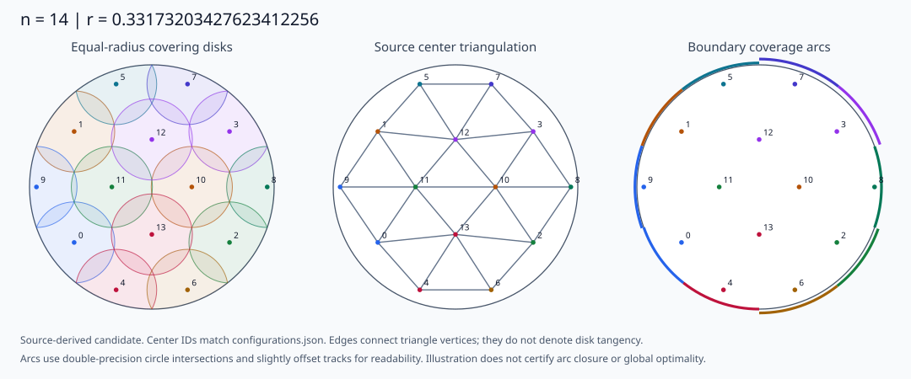
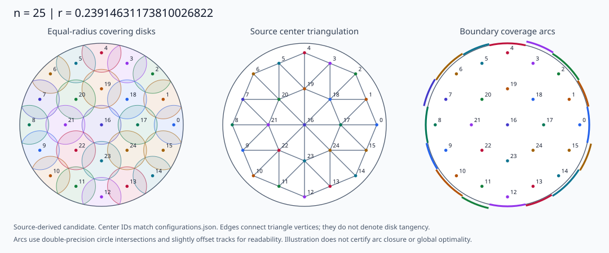

# Source-derived covering configurations

The figures show actual center coordinates from the saved source constructions,
normalized to the closed unit disk. They are geometric illustrations of those
constructions. Drawing a covering configuration establishes neither an unrestricted
lower bound nor uniqueness of optimal configurations. The mathematical status of
each order remains the one stated in its `coverN` entry and acceptance scope.

The generator uses Python's standard library and the small input snapshots shipped
with the gallery. It needs no Windows path mapping, optimizer, plotting package,
large-file restoration, network access, or local research workspace:

```sh
python tools/generate_gallery.py
python tools/generate_gallery.py --check
```

The second command checks the SHA256 of each input snapshot, reconstructs the
figures and coordinate tables, and compares the generated bytes with the saved
outputs. It also checks source root identities and a few extraction consistency
conditions. Its `GALLERY PASS` message is **not a mathematical proof acceptance
result**: it does not rerun root isolation, all terminal boxes, or a global lower
bound. The distinct mathematical checker is described in [verification guidance](../README.md).

New rendering code, the five newly drawn SVGs, and generated factual coordinate
and radius tables are available under MIT, as specified in
[LICENSE_SCOPE.md](LICENSE_SCOPE.md). The verbatim source snapshots under
`assets/configurations/sources/` and the original `proof_bundle` files retain their
original provenance and licensing scope; this gallery does not relicense them.

## Radius navigation

These are **rounded values to 20 decimal places**, obtained only when both ends
of a saved rational enclosure round to the same value. They are not exact root
definitions or truncated decimal prefixes. In particular, the rounded n=22 value
ends in `08`, while its decimal expansion at that point begins `...077...`.

| n | Source candidate radius, rounded | Exact object | Documented candidate symmetry | Drawing |
|---|---|---|---|---|
| 11 | 0.37998385311983868972 | Radius coordinate of the isolated 12-variable symmetric TC/KKT root | Reflection across the x axis, from the parametrization | [SVG](../assets/configurations/n11.svg) |
| 12 | 0.36110296374450864411 | Radius coordinate of the isolated four-polynomial F,G,H,T root | D3, from the construction | [SVG](../assets/configurations/n12.svg) |
| 14 | 0.33173203427623412256 | Radius coordinate of the isolated positive-radical F,G,H root | D2, from the construction | [SVG](../assets/configurations/n14.svg) |
| 21 | 0.26284507240358458065 | Square root of the radius-squared coordinate of the source's isolated core root | Not asserted here | Not included |
| 22 | 0.25325145983509235808 | $r=\sqrt t$, with $29t^3-55t^2+19t-1=0$ and $641/10000<t<321/5000$ | D7, identified by the source root transport | [SVG](../assets/configurations/n22.svg) |
| 23 | 0.24995377658605018325 | Square root of the radius-squared coordinate of the source's isolated core root | Not asserted here | Not included |
| 24 | 0.24530165016852390995 | Square root of the radius-squared coordinate of the source's isolated core root | Not asserted here | Not included |
| 25 | 0.23914631173810026822 | $r=1/(\sqrt6+\sqrt3)$, so $r^2=1-2\sqrt2/3$ | Not asserted here | [SVG](../assets/configurations/n25.svg) |

The n=22 cubic is a polynomial for the **squared radius** $t=r^2$, not for $r$.
No unverified minimal polynomial is invented for the other isolated systems.
The symmetry column describes the displayed candidate only. It does not impose
symmetry on arbitrary competing covers or classify all optimal covers.

[radius-index.json](../assets/configurations/radius-index.json) supplies the exact
enclosure endpoints, source paths and SHA256 values for all eight rows, including
root and system identities for 21, 23 and 24. No gallery is supplied for the
unfinished order n=26.

## How to read the drawings

Each SVG has three panels:

1. The equal-radius disks, clipped to the closed unit disk. Center labels are
   zero-based and match the machine-readable table.
2. The source's center triangulation, formed from its explicitly supplied triples.
   These edges are **not disk tangencies**. The faces include the slack triangles
   where those appear in the source construction.
3. The intersection of each covering disk with the unit-circle boundary. The
   displayed arcs are computed from the usual circle-intersection formula in
   double precision. Slightly offset tracks make overlapping arcs visible.
   They are illustrative; numerical closure of their union is not proof evidence.







## Coordinates and exact definitions

[coordinates.csv](../assets/configurations/coordinates.csv) lists all **84 centers**
of the five illustrated configurations in source order. The `x_approx` and
`y_approx` columns contain drawing approximations rounded to 12 decimal places;
these are not certified 12-place center enclosures. The exact-coordinate
definitions are separate. This distinction matters especially for n=11, where
the original isolating coordinate box is wider than the contracted radius box.

[configurations.json](../assets/configurations/configurations.json) includes the
coordinate formulas, every plotted triangle, rational root/radius enclosures,
available coordinate enclosures, and provenance for each configuration. Source
IDs are retained throughout; the CSV never reorders centers to fit a pattern.

### n=11: nine ring centers and two interior centers

Let $z$ be the isolated 12-variable TC/KKT root in the dyadic box recorded in
[n11-root.json](../assets/configurations/sources/n11-root.json). The radius is
$r=z_6$, and define

$$
 (a_0,\ldots,a_8)=(z_0,z_1,z_2,z_3,
 \pi-2(z_0+z_1+z_2+z_3),z_3,z_2,z_1,z_0).
$$

With $\theta_4=0$ and $\theta_{k+1}-\theta_k=a_k+a_{k+1}$,

$$
 \rho_k=\cos a_k-\sqrt{r^2-\sin^2 a_k},\qquad
 c_k=\rho_k(\cos\theta_k,\sin\theta_k)\quad(0\le k<9).
$$

The remaining centers are $c_9=(z_4,0)$ and $c_{10}=(z_5,0)$.
The source convention, cyclic indexing and 11 triangles are preserved from
[the original geometry implementation](../assets/configurations/sources/n11-geometry-source.py)
and [its report](../assets/configurations/sources/n11-triangulation.json).
The more precise radius interval comes from the inclusion-preserving contraction
of this same root, recorded in [n11-radius.json](../assets/configurations/sources/n11-radius.json).
When the independent n11 checker's `math_data/n11/root_input.json` is present,
the generator requires its exact dyadic center/radius to match this source box.

### n=12: exact scaled coordinates

Let $(a,t,r,w)$ be the unique common root of the four explicit polynomials in
[n12-root.json](../assets/configurations/sources/n12-root.json), and put
$b=(1+a+r)/2$. Here $t$ is a coordinate variable of this system; it is **not** the
squared-radius variable used for n=22. The source stores $(x,Y)$, where
$Y=\sqrt3\,y$. In these coordinates a 120-degree rotation is exactly

$$
 \operatorname{rot}(x,Y)=((-x-Y)/2,(3x-Y)/2).
$$

For $k=0,1,2$, centers $3k,3k+1,3k+2$ are respectively
$\operatorname{rot}^k(b,w)$,
$\operatorname{rot}^k(t/2,3t/2)$, and
$\operatorname{rot}^{k+1}(b,-w)$.
Centers $9+k$ are $\operatorname{rot}^k(a,0)$.
These are scaled coordinates; divide the second component by $\sqrt3$ before
plotting. The generator rebuilds all their rational interval bounds and requires
exact equality with [n12-geometry.json](../assets/configurations/sources/n12-geometry.json).
Its 13 source faces retain the same labels.

### n=14: positive radical branches

For the isolated root $(z,c,r)$ in
[n14-root.json](../assets/configurations/sources/n14-root.json), define

$$
 s=\sqrt{1-r^2},\quad a=(s+z)/2,\quad
 t=r+\sqrt{r^2-z^2},\quad
 b=r+\sqrt{r^2-(a-z)^2},\quad d=1-\sqrt{r^2-c^2}.
$$

The centers are $(\pm a,\pm b)$, $(\pm c,\pm d)$, $(\pm s,0)$,
$(\pm z,0)$ and $(0,\pm t)$, with independent signs in the four-point orbits.
All radicals use the source's positive branches. The exact root equations and
attainment argument are in [the source definition](../assets/configurations/sources/n14-definition.md).
The ordering and 16 retained nearest-site triangles, including two slack ones,
come from [n14-geometry.json](../assets/configurations/sources/n14-geometry.json).

### n=22: a complete small closed-form construction

The source [radius-link derivation](../assets/configurations/sources/n22-radius-link.md)
identifies the full core root with the cubic radius and D7 construction; it does
not infer symmetry of arbitrary competitors. Put

$$
 \theta=2\pi/7,\quad c=\cos\theta,\quad s=\sin\theta,\quad
 a=2r\cos(\theta/2),\quad
 X=\frac{1+4a^2-r^2}{4a},\quad
 Y=-\frac{(1-c)(1-r^2)}{4as},\quad e=(X,-Y).
$$

Let $R$ rotate by $\theta$. For $k=0,\ldots,6$, the boundary-center labels are

$$
 c_{2k}=a(R^{k-1}e+R^ke),\qquad c_{2k+1}=2aR^ke.
$$

The seven inner-ring centers are $aR^ke$; there is also the origin. In source ID
order, centers 14–21 have exponents $0$, origin, $4$, $5$, $6$, $1$, $2$, $3$.
This specifies all centers without the large Newton preconditioner.

The gallery also extracts the coordinate seed of the original 252-variable core
root, using the exact center-node mapping in
[n22-core-system.json](../assets/configurations/sources/n22-core-system.json),
and checks that its drawing coordinates agree with the closed-form construction.
The [small root extract](../assets/configurations/sources/n22-core-root-extract.json)
contains the coordinate seed and squared-radius seed, **not the omitted inverse
preconditioner or a standalone root-isolation certificate**. Its original root
SHA256 and size are recorded. The preserved
[root report](../assets/configurations/sources/n22-root-verified.json) and
[symmetry report](../assets/configurations/sources/n22-symmetry.json) bind the same
root and system. The 28 center faces come directly from that system.

### n=25: exact coefficients in a quadratic field

Let $a=\sqrt{(2-\sqrt2)/3}$. In
[n25-geometry.json](../assets/configurations/sources/n25-geometry.json), each
coefficient pair `[u,v]` represents $u+v\sqrt2$, and a physical point is $a$ times
its two stored coefficients. The JSON supplies all 25 centers and 32 center
faces. The source
[exact-field checker](../assets/configurations/sources/n25-geometry-source.py)
and [upper report](../assets/configurations/sources/n25-upper-verified.json)
specify the same construction at $r=1/(\sqrt6+\sqrt3)$.
The gallery does not add a symmetry-group classification for it.

## Provenance and precision

[provenance.json](../assets/configurations/provenance.json) records the original
workspace-relative path, original SHA256, snapshot SHA256 and byte length for
each of the 22 inputs. Twenty-one are verbatim small source files. The n=22 root
is a documented field extraction; the original 5 MB preconditioner is not copied
into this gallery. A `delivered_source` is given only where the file is actually
present as a direct path in the baseline repository. Some additional small source
reports are supplied here as snapshots, instead of pretending their original
paths were already delivered.

For n=21, 23 and 24, this gallery supplies only small saved radius-isolation
reports and their original root/system SHA256 values. These source reports are
used for navigation and decimal precision, not as substitutes for the root
certificates or the original global proof dependency trees.

The original proof files and delivery manifests are unchanged by this gallery.
Root existence, boundary coverage, face inequalities and the global lower-bound
chain require their own mathematical acceptors. Rebuilding these figures is a
separate, inexpensive way to inspect the constructions and their source labels.
